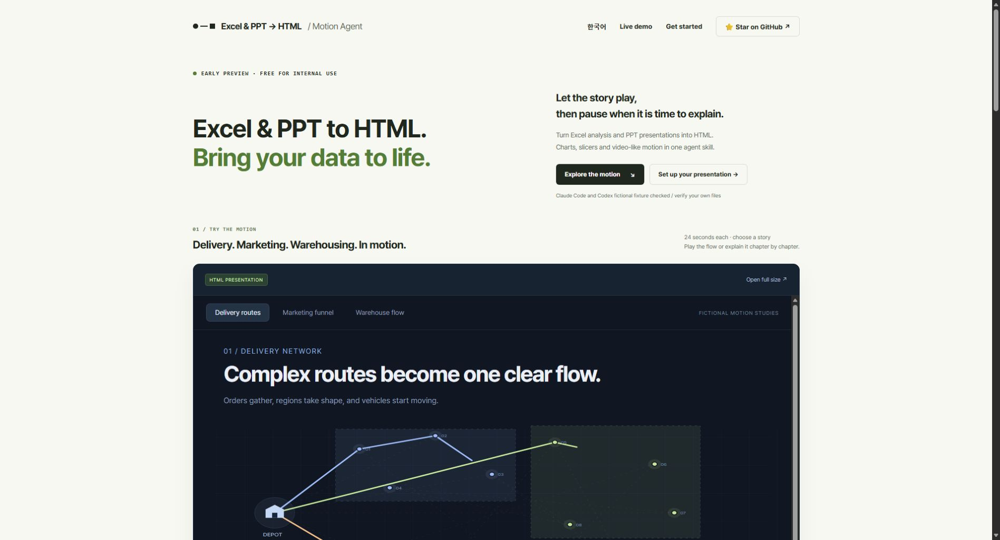
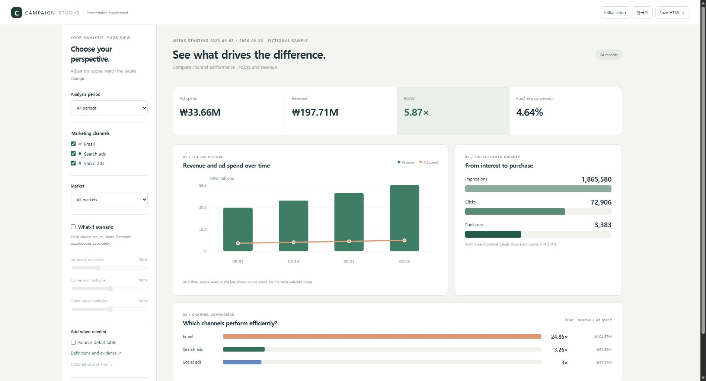
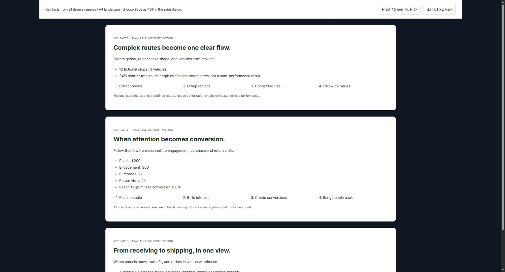
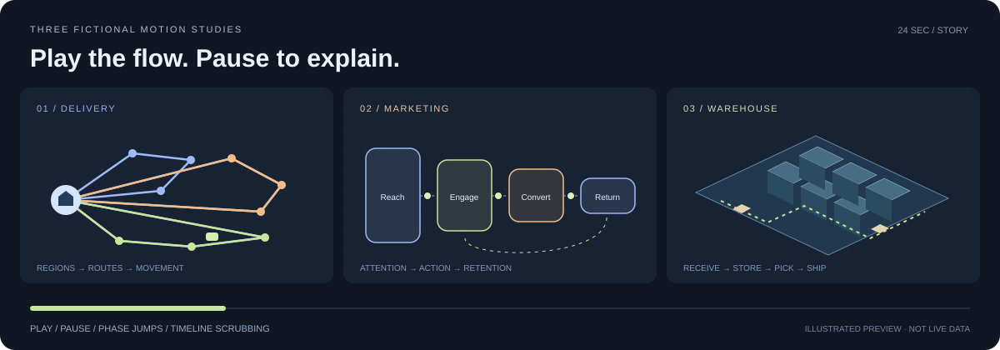

# Excel & PPT → HTML · Motion Agent

**Finding this useful? [⭐ Star this repository](https://github.com/Chris-yoo80/ppt-to-html-agent)** — your support encourages the next update. Stars are optional; download and use the skill anytime.

**Excel and PPT to HTML — with charts, slicers and video-like motion.**

A source-available agent skill for turning PPT content into interactive HTML presentations and reviewed Excel analysis into supporting HTML, with charts, slicers and video-like motion. Motion plays inside HTML; MP4 export is deferred. Play a process, pause to explain, or open the evidence without losing your place. A fictional PPTX workflow was tested in Claude Code and Codex CLI; broader file/host compatibility still needs validation.

[한국어](README.ko.md) · [Install](docs/install.md) · [Verification](docs/verification.md) · [Release status](docs/release-plan.md)

[English HTML guide](https://chris-yoo80.github.io/ppt-to-html-agent/guide.en.html) · [한국어 HTML 설명서](https://chris-yoo80.github.io/ppt-to-html-agent/guide.ko.html) · [Presentation + supporting HTML](https://chris-yoo80.github.io/ppt-to-html-agent/marketing-presentation.en.html)

## Quick start — three steps

1. **Get the skill.** Clone this repository or download the [portable skill ZIP](docs/downloads/ppt-to-html.zip).
2. **Install it for your coding agent.** Put `ppt-to-html` in `.claude/skills/` for Claude Code or `.agents/skills/` for Codex. Follow the exact paths in [Install](docs/install.md).
3. **Create the HTML.** Put an accessible `.pptx`, `.xlsx` or supported JSON source in your working folder, request `/ppt-to-html` in Claude Code or `$ppt-to-html` in Codex, answer the brief, review the contents and representative scene, then let the agent build and verify the offline HTML.

Regular ChatGPT and Claude web chats cannot run this local skill. Legacy `.ppt` and password-protected files are unsupported. The agent uses source content to redesign the narrative; it does not reproduce the original slide layout pixel for pixel.

| 1. See the full story | 2. Review interactive evidence | 3. Check motion-off and print |
|---|---|---|
|  |  |  |

The [complete presentation example](docs/full-presentation.en.html) contains all seven scenes from contents and overview through the main discussion, timeline and conclusion. It makes the end-to-end conversion scope visible instead of showing only a short highlight.

## Supporting HTML, inside the presentation

Open **Additional resources** to view the fictional marketing analysis or the HTML user guide. The presentation pauses and keeps its current reveal; the analysis keeps its settings when you switch resources or return later in the same session.

The initial brief asks about PDF output and backup-resource placement. **Print / PDF** previews every scene with all reveals visible; save through the browser print dialog. Analysis prints the current filters separately. Backup HTML uses labeled resource tabs; raw workbook attachments are opt-in.


Start with purpose, metrics, screen, font and sharing settings. Use period/channel/market slicers on the left and weighted KPIs, trends, funnel counts and channel charts on the right. Add detail tables and explicitly hypothetical scenarios after the basics. Save HTML retains the current analysis settings. No raw workbook is attached automatically; disabling CSV buttons does not remove the data embedded in HTML.

The new sample contains 24 original fictional records, not measured results or arbitrary Excel formula conversion. See the [real-browser verification record](docs/browser-verification-2026-10-23.md). Standalone file reopening (`file://`) remains unverified due to browser policy.

```sh
python skills/ppt-to-html/scripts/build_analysis.py examples/marketing-analysis/data.json --language en --output output/marketing-analysis.html
python skills/ppt-to-html/scripts/build_deck.py examples/marketing-analysis/presentation.en.json --supplement "Marketing analysis=output/marketing-analysis.html" --output output/presentation.html
```



## See the motion

| Story | What unfolds | Controls |
|---|---|---|
| Delivery network | Orders → regions → prescribed routes → moving vehicles | Play, pause, four phase jumps, scrub |
| Marketing journey | Reach → engagement → conversion → return flow | Play, pause, four phase jumps, scrub |
| Warehouse operations | Receiving → storage → picking → shipping | Play, pause, four phase jumps, scrub |

Each story lasts 24 seconds and stops at the end. The illustration above is a static preview; open `docs/index.html` in an allowed browser for the interactive gallery. [Try the English demo](https://chris-yoo80.github.io/ppt-to-html-agent/index.en.html) · [한국어](https://chris-yoo80.github.io/ppt-to-html-agent/).

The scenes and data are fictional and hand-authored. The delivery percentage compares prescribed paths on an invented coordinate plane; it is not an optimizer performance result. The gallery demonstrates controllable HTML motion, not a completed automatic PPT-to-HTML run.

Build the self-contained motion gallery with Python 3.10+:

```sh
python skills/ppt-to-html/scripts/build_motion_demo.py examples/motion-stories/stories.json --output output/motion-stories.html
```

Open `output/motion-stories.html`; no runtime server, framework, AI key or network connection is needed for this prebuilt fictional gallery. Running the agent on your own PPT uses your existing AI environment and its applicable charges.

## What you get

- A skill package: instructions, references, Python helpers and a self-contained HTML player.
- A brief before building: audience, duration, dimensions, fonts, motion frequency and playback.
- PPTX extraction: text, tables, speaker notes and media inventory, in presentation order.
- A portable starter: the agent writes scene JSON; the builder renders an offline HTML file.
- Simple motion graphics: point entrances, connecting lines and plane reveals, with reduced-motion handling.
- A motion gallery: fictional delivery routes, a marketing funnel and an isometric warehouse, with continuous playback, four phase jumps and timeline scrubbing. These are hand-authored presets, not automatic PPT conversion or an optimization solver.
- A smaller library example remains as a starter for the scene-JSON builder.
- A static introduction page: demo and local prompt generator. No upload form, AI connection, tracking or runtime CDN dependencies.

The Package is source-available under the project-specific [Community License 1.0](LICENSE), with free personal, noncommercial and internal organizational use. Reselling the tool, including it in a paid tool, or operating an external generation/conversion business requires separate written permission. Completed presentation outputs can be shared and delivered for reporting, proposals, training and customer presentations under the output exception. Retain legal notices. This is not MIT or an OSI-approved open source license. [한국어 사용 조건](docs/license.ko.md)

These are project-specific terms, not independently reviewed standard-license advice. AI subscriptions and API usage follow your provider's terms.

The website and fictional demo use Story Sans, renamed character subsets derived from Pretendard 1.3.9. These font files retain their separate [SIL Open Font License](skills/ppt-to-html/assets/fonts/OFL.txt) and are not relicensed under the Community License. They cover the current demo; other characters fall back to the system font. The `story` preset embeds the font files and notices in the generated HTML.

## How the agent works

```text
PPTX → extract source → ask the brief → propose scenes
     → review a representative scene → author HTML → verify → refine
```

The host AI interprets the source and designs the narrative. The scripts do not call an AI model or automatically invent a scene plan. Preserve source figures and meaning, mark illustrative material, and ask only for missing preferences.

## Try the builder

Python 3.10+; standard library only:

```sh
python skills/ppt-to-html/scripts/build_deck.py examples/library/deck.json --output output/library.html
```

Open `output/library.html` in an authorized browser. It embeds its content, CSS and JavaScript. Use the visible controls or arrow keys to progress; the last step stops. **Contents** or `G` opens every scene and reveal step for direct navigation. **Mark question** or `B` saves the current scene and step, `Shift+B` opens all marked questions, and **Return to question** or `R` returns to the latest mark. Marks remain available when you open and close Additional resources in the same presentation session.

Extract an accessible PPTX:

```sh
python skills/ppt-to-html/scripts/extract_pptx.py private-inputs/input.pptx --output work/source.json
```

This extracts source information, including potentially private notes. It does not build the narrative. [Install the skill](docs/install.md) and ask the agent to turn the extracted material into a reviewed scene plan. Keep business input and output outside public commits.

## Start a presentation

```text
Use the ppt-to-html skill to turn my PPT into an HTML presentation.
Ask about the audience, time, screen size, fonts, motion frequency,
playback and point-line-plane graphics before building.
Show me the outline and one representative scene first.
```

The [intake reference](skills/ppt-to-html/references/intake.md) defines the starting questions. The generated HTML uses finite SVG/CSS animation rather than an exported video. A [portable skill ZIP](docs/downloads/ppt-to-html.zip) contains the license, skill instructions, references, scripts and assets; see the installation guide for where to unpack it.

## Website and demo

`docs/index.html` is a buildless GitHub Pages introduction page. `docs/demo.html` is generated from `examples/motion-stories/stories.json`; `docs/library-demo.html` retains the smaller starter. The website builds a request prompt locally; visitors run the actual agent in their own AI environment.

GitHub Pages serves the bilingual introduction, HTML guides and examples from `main` → `/docs`. Rebuild guides with `python tools/build_guides.py`, supporting examples with `python tools/build_marketing_examples.py`, and the English landing page with `python tools/localize_site.py`.

## Current limits

- No pixel-perfect PPT rendering, image OCR, chart workbook interpretation, legacy `.ppt`, or encrypted/DRM document reader.
- The starter supports 1–4 short items per scene, cards/flow/compare layouts and three diagram styles. Richer layouts and custom fonts require additional implementation.
- Extraction has synthetic fixture tests. The library example demonstrates JSON-to-HTML generation, not a complete PPT-to-HTML conversion.
- Static and syntax checks do not prove visual quality. Browser layout, interaction, accessibility and alternative ratios still require verification.
- One fictional five-slide conversion and revision completed in Claude Code and Codex CLI. Other files, hosts and regular ChatGPT/Claude surfaces are not claimed as universally supported.
- MP4 export, a hosted AI conversion app and verified multipage PDF output are deferred.

Motion demos retain a static **Key facts** summary with all essential figures and four phases. **Turn motion off** keeps manual navigation; **Print / PDF** previews all three complete summaries. Presentation reduced-motion mode reveals every item in the current scene and pauses autoplay. Returning from print preserves story/time or step, paused. Saved-PDF layout is a separate check.

## Numeric review

Unit review also covers **length, area, volume, mass, time, speed, energy/power and compound/business units**. The offline unit helper checks supported declared conversions and flags unknown units, incompatible dimensions or missing packing factors as Needs review. It does not automatically interpret arbitrary workbooks or change the KRW campaign charts. See the [fictional unit examples](examples/unit-verification/README.md).


Numeric review checks **units/conversions, denominators, filters/ranges, rounding, motion-off/print retention and source sheet/range**. The evidence dialog exposes those definitions and the current selection. Final reports mark each item **Passed / Needs review** with evidence; embedded metadata alone is not a source audit. See [numeric verification results](docs/verification.md#feedback-1-numeric-verification).

## Development checks

```sh
python -m unittest discover -s tests -v
node --check skills/ppt-to-html/assets/player.js
node --check docs/site.js
python skills/ppt-to-html/scripts/build_deck.py examples/library/deck.json --output docs/library-demo.html
python skills/ppt-to-html/scripts/build_motion_demo.py examples/motion-stories/stories.json --output docs/demo.html
node --test tests/motion.test.cjs
```

The CI workflow also checks the motion runtime's JavaScript syntax, geometry tests and generated artifacts.

## Contributing

Useful contributions include fictional PPTX fixtures, reproducible layout failures, better scene templates and host-specific installation feedback. Include target dimensions, reproduction steps and expected behavior. Do not submit client decks, internal figures, speaker notes, credentials or proprietary media.
